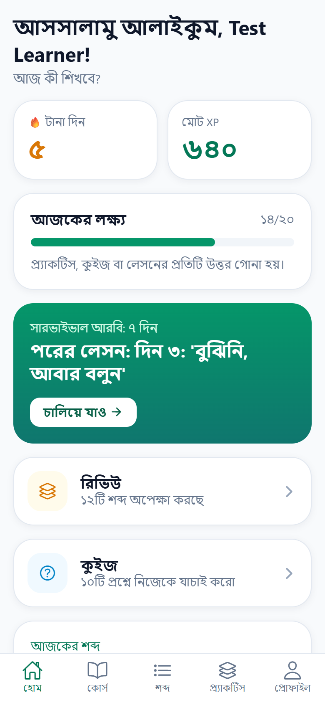
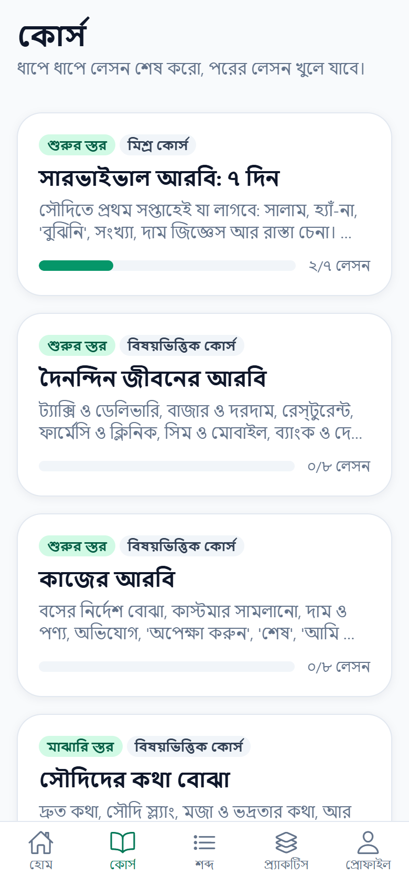
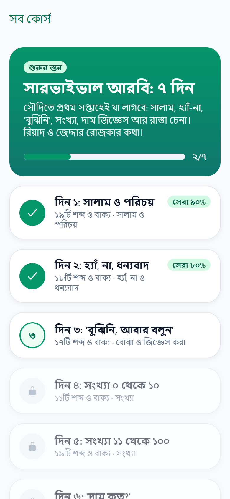
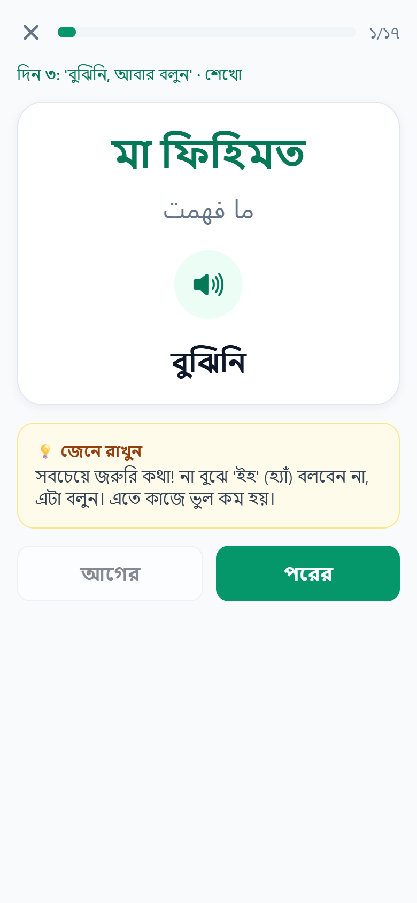
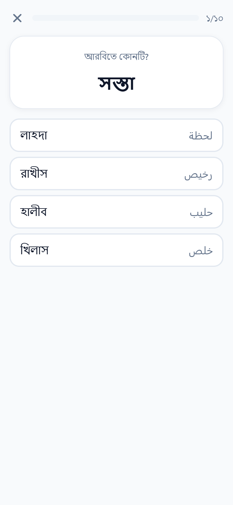
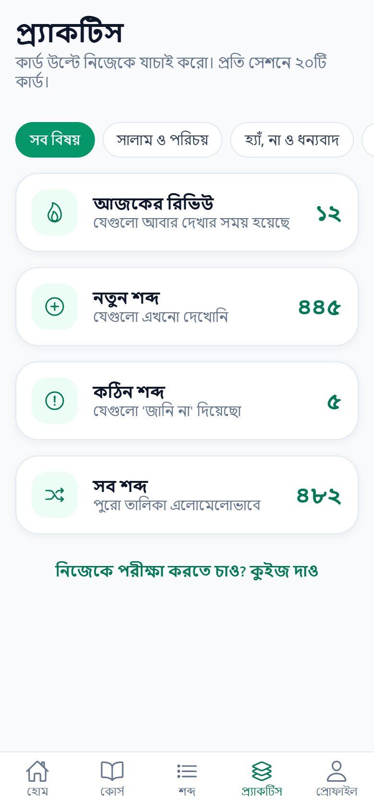
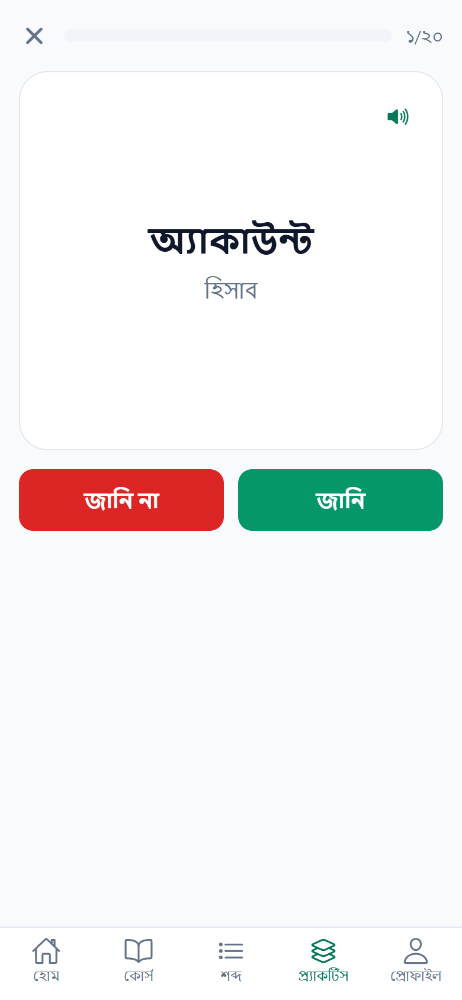
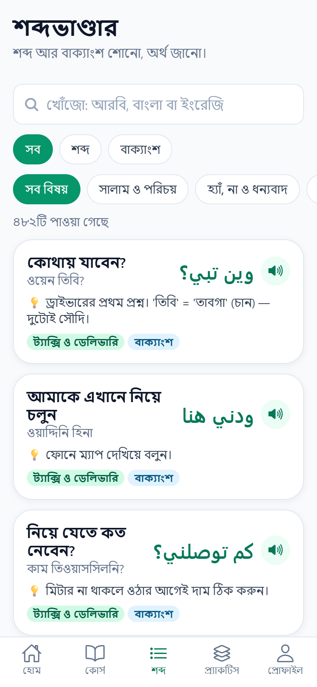
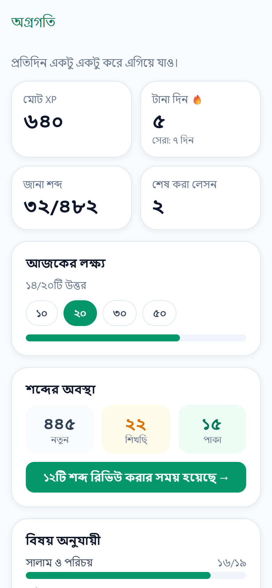

# Lahjio for Android

Learn Saudi Arabic in your own language: the Android app of [lahjio.com](https://lahjio.com),
built with Expo (React Native) and TypeScript. It shares the website's Firebase project,
so progress is the same on both.

## Screenshots

Version 1, in Bangla (the app is also in English, Hindi and Urdu).

<table>
  <tr>
    <td align="center"><br>Welcome</td>
    <td align="center"><br>Home</td>
    <td align="center"><br>Courses</td>
  </tr>
  <tr>
    <td align="center"><br>Course</td>
    <td align="center"><br>Lesson</td>
    <td align="center"><br>Quiz</td>
  </tr>
  <tr>
    <td align="center"><br>Practice</td>
    <td align="center"><br>Flashcard</td>
    <td align="center"><br>Word library</td>
  </tr>
  <tr>
    <td align="center"><br>Progress</td>
    <td></td>
    <td></td>
  </tr>
</table>

## Run it on your phone

1. Install **Expo Go** from the Play Store.
2. Copy `.env.example` to `.env` and fill in the Firebase web config (same values as the website).
3. Install and start:

   ```bash
   npm install
   npm start
   ```

4. Scan the QR code with Expo Go. Phone and computer must be on the same Wi-Fi
   (or use `npm run start:tunnel`).

## Build an APK

```bash
npm run apk
```

The APK is saved to `apk/lahjio-<version>.apk`. See `CLAUDE.md` for details.

## Checks

```bash
npm run typecheck
npm run lint
npm run check:i18n
npm run doctor
```

See `CLAUDE.md` for how the code is organised and how to test with the local Firebase emulators.
